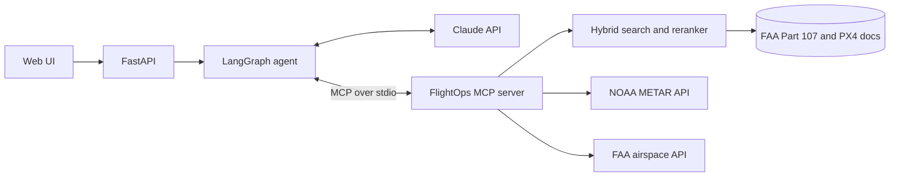

# FlightOps Copilot

An AI agent for small drone operators. It answers questions about FAA Part 107 and the PX4 autopilot from the source documents, and checks live weather and airspace through its own MCP server.

> Portfolio project for planning support only. It doesn't replace LAANC authorization, NOTAM and TFR checks, or the remote pilot in command's judgment.

## What it does

| Ask | What happens |
|---|---|
| "How far do I have to stay from clouds?" | Searches the regulations and cites 14 CFR 107.51 |
| "What does PX4 do when the data link is lost?" | Searches the PX4 docs and cites the safety page |
| "Does the weather at KPHX allow a flight at 200 ft?" | Pulls the live METAR, then checks it against Part 107 limits in plain code |
| "Do I need authorization at 33.43, -111.97?" | Queries the FAA airspace dataset (here, Phoenix Class B: yes) |

## How it works



Design choices worth noting:

- **Safety limits are code, not model output.** The 3-mile visibility, 500 ft cloud clearance and 400 ft altitude checks are deterministic and unit tested. Claude explains the result but doesn't decide it.
- **Tools sit behind a real MCP boundary.** The server runs as its own process, so other MCP clients can use it too.
- **Unknown is not pass.** Missing visibility returns `unknown`, and each check lists what a METAR can't show, such as conditions at a site miles from the station.
- **Failures are visible.** Tool errors go back to Claude with their reason, runaway loops stop after 8 model turns, and refusals and truncated answers are labeled.
- **Each run is traced.** `traces/runs.jsonl` records latency, tokens, estimated cost and tool calls.

## Measured results

### Retrieval

48 hand-labeled questions over 460 chunks (33 PX4 pages and FAA Part 107). A hit means a chunk from a labeled document ranked in the top N. Run it yourself with `python evals/retrieval_eval.py`; it needs no API key.

| Search mode | Hit@1 | Hit@5 | MRR@10 |
|---|---|---|---|
| BM25 keyword | 27.1% | 54.2% | 0.401 |
| Dense embeddings | 62.5% | 85.4% | 0.713 |
| Hybrid (BM25 + dense, RRF) | 56.2% | 77.1% | 0.653 |
| **Hybrid + cross-encoder rerank** | **66.7%** | **89.6%** | **0.773** |

What this shows:

- Reranking gave the best result, and the agent uses that mode.
- Hybrid fusion alone did worse than dense search on this set. The questions are deliberately paraphrased, which hurts keyword search, and fusion lets those weak keyword results dilute good dense ones.
- This is a small set, labeled by the project's authors, and nothing was tuned against it. Each question is worth about 2 points, so treat small gaps as noise. There is no separate held-out test set.
- `evals/results/retrieval.json` lists the questions that missed.

CI fails if reranked Hit@5 drops below 80%.

### Answers

`evals/answer_eval.py` runs 13 end-to-end cases on live Claude (`claude-opus-5-5`) and grades them in code: required facts, required tools and citation of the required document.

| Measure | Result |
|---|---|
| Cases passed | 13 of 13 |
| Median time per question | 8.5 s |
| Slowest question | 16.5 s |
| Average cost per question | $0.023 |

How far to trust this:

- It's one run of a small set, written by the project's authors, and most questions are direct lookups.
- The grader checks for required content, not every sentence. The answers in `evals/results/answers.json` were also read by hand.
- Live weather and airspace cases can't check values that change, so they confirm the right tool ran and the answer has the expected content.
- Answers sometimes add correct details from the model's own knowledge, such as FAA DroneZone, even though the prompt asks it to rely on tool results.

### Tests

The test suite makes no paid API calls. Agent tests use the real Anthropic SDK with only the network mocked, so request format and response parsing are exercised. MCP tests include a real subprocess.

## Run it

Requires Python 3.11 to 3.13.

```bash
python -m venv .venv
source .venv/bin/activate        # Windows: .venv\Scripts\activate
pip install -e ".[dev]"
cp .env.example .env             # Add ANTHROPIC_API_KEY to use the agent
uvicorn flightops.api:app --port 8000
```

Open http://localhost:8000. Without a key, document search still works and the agent explains that it's off. The first search downloads two small ONNX models.

```bash
pytest                                # Tests
python evals/retrieval_eval.py --gate # Retrieval eval, free
python evals/answer_eval.py --yes     # Answer eval, spends API credits
python -m flightops.ingest            # Refresh the documents
python -m flightops.mcp_server        # Run the MCP server on its own
```

## Known limitations

- The app isn't deployed anywhere, so it runs locally with your own API key.
- The Dockerfile hasn't been built or tested.
- The airspace check only looks for controlled layers reaching the surface. It doesn't check TFRs, NOTAMs, LAANC grid ceilings, special-use airspace or stadium restrictions.
- METARs describe the reporting station, not your flight site, and only cover airports that report.
- PX4 coverage is limited to flying, flight mode and safety pages, mostly for multicopters.
- Search loads an in-memory index, which suits this corpus size but wouldn't suit a large one.

## Data sources

- [14 CFR Part 107](https://www.ecfr.gov/current/title-14/chapter-I/subchapter-F/part-107) from the eCFR (US government work). Snapshot date is in `data/manifest.json`.
- [PX4 User Guide](https://docs.px4.io/main/en/), © PX4 Dev Team, [CC BY 4.0](https://creativecommons.org/licenses/by/4.0/). Excerpts in `data/corpus.jsonl` were cleaned of markup and split into chunks. The commit is pinned in `data/manifest.json`.
- Live data from the [NOAA Aviation Weather Center](https://aviationweather.gov/data/api/) and the [FAA Class Airspace dataset](https://adds-faa.opendata.arcgis.com/).


